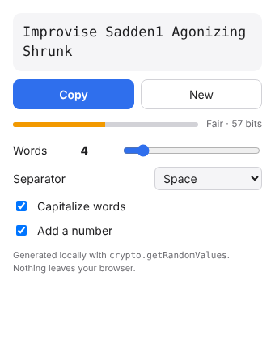

# Passphrase Generator (Chrome extension)

Generates diceware-style passphrases offline, e.g. `surreal-never-extent-campus-coauthor-issue`.

- Words are drawn from the EFF Large Wordlist (7,776 words, ~12.9 bits each).
- Randomness comes from `crypto.getRandomValues` with rejection sampling, so there is no modulo bias.
- The popup has quick options: word count (3–12), separator (preset or custom), capitalization (lowercase, First Letter, ALL CAPS, random words), and a preset picker.
- **More customization** opens a full settings page in a tab, with:
  - digits and symbols, including which symbols to use and whether to spread them across words or keep them together
  - your own word list, a word length range, and words to never use
  - named presets you can save, load, overwrite and delete
  The strength meter updates for every setting.
- Settings persist via `chrome.storage`.
- **On websites:** when you click into a new password field (sign-up or change-password forms), a small card offers a passphrase. **Use passphrase** fills the password and confirm fields (never a "current password" field) and copies it to your clipboard. Log-in fields are left alone. You can turn this off on the settings page.
- There are no network requests or analytics. Permissions: `storage`, plus a content script on http/https pages for the password field card, so Chrome warns that the extension can "read and change your data on all websites". The script only looks at password fields and never sends anything anywhere.

## Install (developer mode)
1. Open `chrome://extensions` and turn on **Developer mode**.
2. Click **Load unpacked** and pick this folder.

## Credits
Wordlist: [EFF](https://www.eff.org/dice), CC BY 3.0 US.
